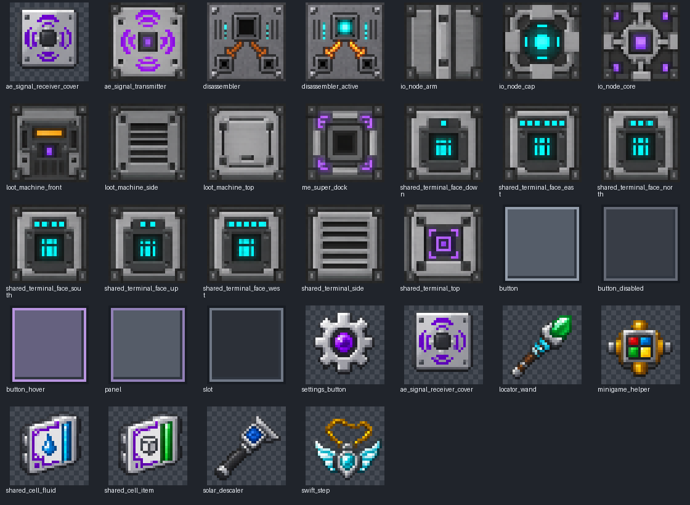

# 1.29.1 改动与交付说明

基于正式版 `v1.29.0`（`514ec56`），完成游戏内界面的 ModularUI2 控件迁移、GT/AE 风格资源重绘，并修复该版本 AE 联动中的问题。

## 界面

- 明确依赖 ModularUI2 `2.3.89-1.7.10`，与当前 GT5U `5.09.54.175` 对齐。
- 设置、共享终端、存量上限、终端 IO、IO 节点、抽奖机、无线发信端、迅步、定位杖、小游戏助手、地牢地图和 RTS 顶栏使用统一 MUI2 控件树，支持动态标签、图标、悬停、禁用、选中状态以及重建与关闭生命周期。
- 终端中键存量弹窗的按钮也迁移到 MUI2。背包设置入口、匠魂共享搜索面板、白名单网格和搜索框使用统一 MUI2 主题。
- 拆解机、超级对接站和 AE 接收覆盖板采用 GT 的原生 MUI2 界面；前两者强制走 MUI2，避免 GT 全局开关将它们转到旧界面。
- 设置面板按可用高度压缩行距；灰色面板使用高对比文字。面板绘制重置颜色，控件层恢复 GL 状态。

迁移采用 MUI2 的 `constructOverlay` API，保留现有服务端 Container、窗口号、库存槽、NEI/MouseTweaks 钩子和业务网络包。GuiButton 只保存业务控件数据，绘制和按钮点击交给 MUI2 ButtonWidget，并保留 Forge 的点击前后事件。中文输入继续走已有的 FutaSearchField/原生 IME；虚拟库存、地图和世界画布保留专用渲染。手机合成向导为浏览器页面，不属于 Minecraft MUI2 的适用范围。

## 贴图

- 重绘全部现有方块、方块实体渲染部件及物品图标：共享终端六面、抽奖机、IO 节点核心/臂/端盖、无线发信端、接收覆盖板、迅步、太阳能除钙剂、定位杖、小游戏助手和共享物品/流体存储元件。
- 新增超级对接站正面、拆解机静止/运行正面，以及统一面板/按钮/悬停/禁用/槽位九宫格；设置齿轮同步更新。
- 所有资源为 32×32 RGBA；物品使用二值透明度。共享终端六面的 1–6 指示编号保持原顺序。没有独立生物实体贴图，本项目的 IO 方块实体渲染复用上述部件纹理。
- 资源名称稳定，可继续由资源包替换。删除不再引用的整张终端、抽奖机旧 GUI 图。

生成提示词及安装方法见 [贴图生成记录](1.29.1-贴图生成记录.md)；不要运行历史占位纹理生成工具覆盖新版资源。

## 1.29.0 检查与修复

- 无线发信端改名原先只校验队伍且在网络线程改世界状态。现在排入服务端 tick，校验正在查看的容器、维度坐标、当前 TileEntity、距离和管理权限；停服清空队列。
- 发信端配置容器补齐不可见玩家库存槽，避免右键开配置界面的热栏物品校正缺槽。空玩家不能获得管理权限，候选列表剔除已失效节点。
- UTF-8 截断和名字长度限制保留完整字符，避免长中文/表情出现替换字符；名字过滤控制字符，不能注入候选列表分隔符。客户端只使用当前坐标快照，初次同步不会覆盖已经输入的名字，Esc 可以在输入框聚焦时关闭。
- 对接站容器槽限制为一个机器物品。旧 ME 库存句柄在容器移走、替换或异常堆叠后拒绝读写，避免继续修改已取出的物品。
- 对接站流体匹配包含 NBT，首次注入保留标签并独立复制；开启空罐流体锁时，首次实际填充建立锁定。模拟读写不修改内容或锁定状态，溢出返回准确余量。

## 验证与兼容性

- `gradlew spotlessApply build spotlessCheck`：完整构建及现有回归任务通过。
- 新增 `verifyAeIntegration`：51 项断言，覆盖 GT 真实容量、模拟/实际读写守恒、流体标签、锁定、失效句柄、UTF-8 边界、命名过滤和服务端队列。测试使用 AE 接口输入夹具，执行真实坞站实现；不等同于完整 ME 网络的长时间运行测试。
- 发版规则 `python -m unittest discover -s tools/release -p 'test_*.py' -v`：23 项通过。
- `runClient17 -PuiSmoke`：真实 OpenGL 客户端及隔离单人服务端，11 个界面截图、打开/重建/关闭、设置按钮实际点击检查通过。地牢地图因开发环境未安装 Roguelike 而未进入；已完成代码迁移。截图见 [界面预览](images/1.29.1-ui.png)。
- 贴图尺寸、RGBA、物品透明度和非空资源检查通过。

物品/方块注册名、GT MTE ID、已有保存格式、包判别号和字段顺序不变；无需迁移存档。客户端与服务端都更新到 1.29.1，并确保安装 ModularUI2。小型开发窗口使用 GUI 缩放 1；共享终端的大库存画布仍需要足够的逻辑显示高度。

完整整合包中的 ME 网络接入、跨维度无线控制和真实中文输入法组合仍建议在实际服务器持续使用中观察；以上验证未宣称覆盖这些组合的长时间联机行为。
