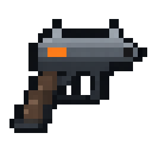

# 待发布：迅步手枪图标修正

迅步的视觉参考是 TD2 随身武器。1.29.1 的重绘误用了带翼饰品造型；本次恢复旧版手枪轮廓，使用银灰金属套筒、深色枪身、棕色握把与橙色识别块。物品功能、注册名和贴图路径保持原样。

最终资源：`src/main/resources/assets/futa_gtnh/textures/items/swift_step.png`（32×32 RGBA，二值透明度）。



版本号保持 1.29.1；只提交并推送源码资源，等待下一次更新，不构建或发布新版。历史 1.29.1 发布包及其资源预览保持不变。

使用内置 ImageGen 的 edit 模式。参考图片为当前图标与 `v1.29.0` 的旧版手枪图标；安装只做最近邻缩小与透明度阈值处理。`tools/texture/import_gt_ae_atlas.py` 保留独立手枪图标，不再从旧物品图集恢复饰品；可用可选第四个参数导入新手枪原图。

## 最终提示词

```text
Use case: precise-object-edit. Asset type: one Minecraft 1.7.10 inventory item sprite for futa_gtnh swift_step (迅步). Image 1 is the edit target: replace this incorrect winged amulet entirely with a pistol. Image 2 is the original pistol icon enlarged by nearest neighbor, serving as the silhouette and identity reference. Primary request: restore a Tom Clancy's The Division 2 inspired modern compact sidearm pistol, drawn as crisp GregTech-compatible Minecraft pixel art. Preserve the original side profile: silver-grey metal slide and upper sights, dark charcoal frame with a clearly open trigger guard, a small orange Division-style rectangular accent near the rear of the slide, dark brown angled grip extending down-left, muzzle pointing right. The weapon must immediately read as a handgun at 32x32 pixels. A single centered isolated pistol, using about 85% of a square canvas, genuinely transparent background. Use an intentionally coarse 32x32 logical pixel grid, each pixel a crisp uniform square, with hard nearest-neighbor edges and a restrained iron grey, charcoal, brown and orange palette. No amulet, no necklace, no wings, no crystal, no bullets, no hand or person, no glow, no shadow outside silhouette, no text, no logos, no watermark, no border, no scene. Render only the finished flat inventory sprite.
```
